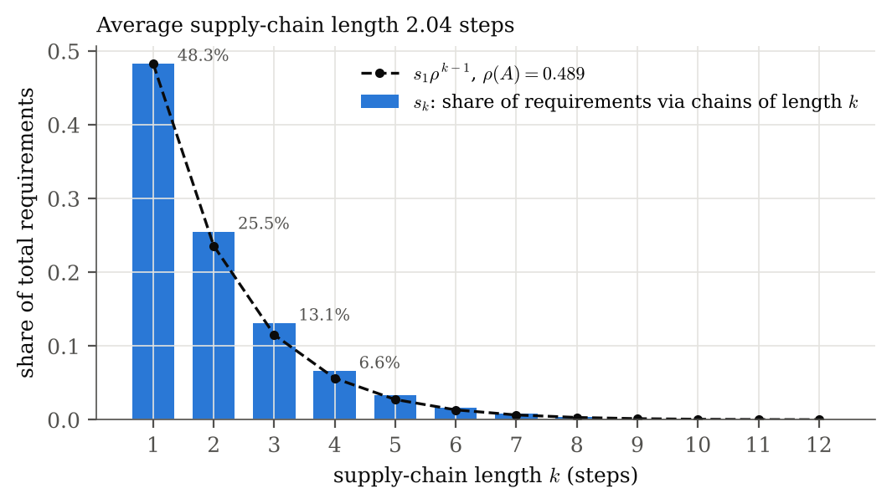
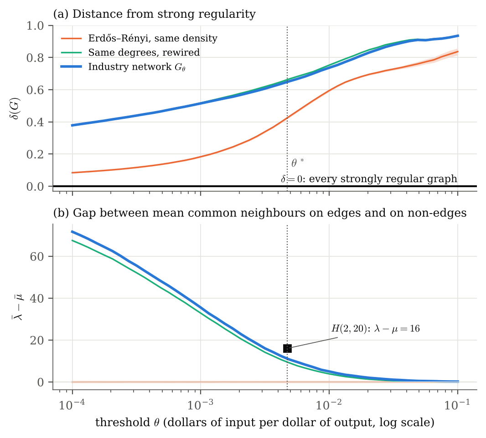

# How far is the US supply-chain network from strong regularity?

**Supply chains between 400 US industries, studied with adjacency matrices, matrix powers and strongly regular graphs.**

This repository holds the supply-chain application section of an undergraduate expository article on graph theory, strongly regular graphs and adjacency matrices. It contains everything needed to reproduce that section from public data, from downloading the US input-output tables to setting each number in the LaTeX:

| | |
|---|---|
| `paper/` | The LaTeX section (`sec-supply-chain.tex`), its bibliography, all figures, and a standalone `preview.pdf` |
| `src/supplygraphs/` | The analysis code, as a small Python package |
| `scripts/` | Three steps that rebuild everything: fetch data → build matrices → run analysis |
| `tests/` | Numerical checks of every theorem and worked example the section uses |
| `notebooks/walkthrough.ipynb` | A step-by-step tour of the analysis, executed, with explanations |
| `results/` | Every computed table and number (`summary.json`, `sweep_2017.csv`, …) |
| `docs/` | The mathematics, the data, the results and how to use the paper files, each in full |

> **Data.** Only public data is used: the Make and Use tables of the US Bureau of Economic Analysis (BEA), as redistributed unchanged by the U.S. EPA's open-source `useeior` package. Every file is pinned to one git commit and checked by SHA-256. See [`docs/DATA.md`](docs/DATA.md).

---

## The idea in one paragraph

Every industry buys inputs from other industries, which buy from others in turn. The BEA tables give a matrix *A* whose entry *a*ᵢⱼ is the number of dollars of industry *i*'s output used to make one dollar of industry *j*'s output. The article's walks theorem, in weighted form, says that (*A*ᵏ)ᵢⱼ adds up all supply chains of exactly *k* steps from *i* to *j*. Summing over *k* gives the Leontief inverse (*I* − *A*)⁻¹ = *I* + *A* + *A*² + ⋯, the standard measure of total requirements. Then we turn *A* into a simple graph, joining two industries when one buys at least θ dollars from the other per dollar of output. We measure how far that graph is from **strongly regular**, the most uniform kind of graph, where every adjacent pair has the same number λ of common neighbours and every non-adjacent pair the same number μ. A random graph is the opposite extreme. The instrument is the article's own definition: the entries of *A*² count common neighbours, so we compare them on edges and on non-edges.

## What we found

Computations on the 2017 BEA tables at the 400-industry level, checked against 2012 and against every year 2012–2023 at the 71-industry level.

**1. Supply chains are short.** The spectral radius of *A* is ρ(*A*) = 0.489. Direct purchases carry 48.3% of all requirements, two-step chains 25.5%, and three-step chains 13.1%. The average supply chain, weighted by the dollars it carries, is **2.04 steps** long. Each extra step carries about half as much as the one before, a factor between 0.490 and 0.528, close to ρ(*A*).



**2. A few service industries supply almost everyone.** At θ\* = 0.0047 (0.47 cents per dollar) the graph has mean degree 38, the degree of the strongly regular Hamming graph *H*(2,20) on 400 vertices. But its degrees are very unequal: standard deviation 37.6, maximum 323. The hubs are *management of companies* (323 links), *truck transportation* (289), *other real estate* (279) and *electric power* (239).

**3. Trading directly predicts shared trading partners, beyond what the hubs explain.**

| At θ\* = 0.0047 | λ̄ (adjacent pairs) | μ̄ (non-adjacent) | gap λ̄ − μ̄ |
|---|---|---|---|
| Industry network | 17.17 | 6.00 | **11.17** |
| Random graph, same density (95% range of gap) | | | [−0.08, 0.07] |
| Random graph, same degree sequence (95% range) | | | [9.32, 9.77] |
| *H*(2,20), strongly regular | 18 | 2 | 16 |

The gap is above both random ranges at every one of the 49 thresholds, in 2012, and in all 12 years at the 71-industry level.

**4. The network is far from strongly regular, mainly because shared-partner counts vary.** We prove (Proposition `prop:residual`) that the best fit of the strongly regular identity *A*² = *kI* + λ*A* + μ(*J* − *I* − *A*) leaves a residual that splits exactly into three variances. At θ\*, δ = **0.649**. Random graphs of the same density give [0.418, 0.433]; graphs with the same degrees give [0.660, 0.665]. 47% of the residual comes from variation in common neighbours across edges, 45% across non-edges, and only **8%** from the unequal degrees.



**5. Stable over time.** From 2012 to 2023, ρ(*A*) stays between 0.471 (2020) and 0.508 (2013), and the average chain length between 1.89 and 2.02 steps. The graph comparisons come out the same way in every year.

Full results, with every table and figure: [`docs/RESULTS.md`](docs/RESULTS.md).

## What is proved, and what is computed

| Claim | Status | Where |
|---|---|---|
| (*A*ᵏ)ᵢⱼ is the total weight of walks of length *k* (weighted walks theorem) | **Proved** | Theorem `thm:weighted-walks`; [`docs/METHODS.md`](docs/METHODS.md) §2 |
| If ρ(*A*) < 1 then (*I* − *A*)⁻¹ = Σ *A*ᵏ ≥ 0 | **Proved** (cites one matrix-analysis fact) | Theorem `thm:neumann` |
| ρ(*A*) ≤ largest column sum | **Proved** | Proposition `prop:colsum` |
| Average chain length = 1ᵀ(*L* − *I*)*L*1 / 1ᵀ(*L* − *I*)1 | **Proved** | Proposition `prop:chain-length` |
| Best fit of the SRG identity splits into three variances; δ = 0 exactly for SRGs | **Proved** | Proposition `prop:residual`, Corollary `cor:delta-zero` |
| In *G*(*n*,*p*), common neighbours ~ Bin(*n*−2, *p*²), independent of adjacency | **Proved** | Proposition `prop:er` |
| *H*(2,20) has parameters (400, 38, 18, 2), eigenvalues 38, 18 (×38), −2 (×361) | **Proved** | METHODS §6 |
| Perron–Frobenius; powers of *A* → 0 iff ρ(*A*) < 1 | **Cited** | Horn & Johnson, *Matrix Analysis* |
| Every number about the US economy | **Computation** on the stated public tables | `results/summary.json` |

The code checks every proved statement numerically (`tests/`, 27 tests), including the weighted walks theorem by brute-force enumeration of walks. These checks guard against typos and bugs; they do not replace the proofs.

**A precision point the data forced.** The usual way to guarantee ρ(*A*) < 1 is that every column of *A* sums to less than 1. That fails here for one industry, state and local government passenger transit, which has negative value added in the tables. So the section computes ρ(*A*) directly instead of relying on the column-sum bound.

## Reproduce it

You need Python 3.10 or newer. About ten minutes on a laptop.

```bash
git clone https://github.com/desaidaksh1206-netizen/supply-chain-graphs-srg.git && cd supply-chain-graphs-srg
python -m venv .venv && source .venv/bin/activate      # Windows: .venv\Scripts\activate
pip install -e ".[dev]"

pytest                               # 1. the theory and data checks (seconds)
python scripts/fetch_data.py         # 2. download the BEA tables, verify checksums
python scripts/build_dataset.py      # 3. build the requirements matrices
python scripts/run_analysis.py       # 4. every number, table and figure (~8 min)
```

Or, with `make`: `make all`. The random seed is fixed, so the numbers come out identical. `data/processed/` is committed, so steps 2–3 can be skipped. The raw R data files (`data/raw/`) are not committed; `fetch_data.py` gets them from the pinned commit and stops if any checksum differs. Reading them needs the `pyreadr` package, which `.[dev]` installs.

## Use it in the article (Overleaf)

Upload `sec-supply-chain.tex`, `refs-supply-chain.bib`, `generated/numbers.tex` and the figures listed in [`docs/PAPER.md`](docs/PAPER.md). Then add to `main.tex`:

```latex
\input{generated/numbers}     % in the preamble, after the theorem environments
...
\input{sec-supply-chain}      % where the application section goes
```

The section refers to four labels that the main article must define: `sec:srg`, `sec:johnson-hamming`, `sec:spectra` and `thm:walks`. Every number in the text is a macro, such as `\GapStar` or `\Rho`. If the analysis is rerun, the text updates itself, so never type a number into the `.tex` file by hand. `paper/preview.pdf` is the section compiled on its own.

## Repository map

```
supply-chain-graphs-srg/
├── README.md
├── docs/
│   ├── METHODS.md             the mathematics, step by step, with proofs
│   ├── DATA.md                sources, checksums, matrix construction, cleaning
│   ├── RESULTS.md             every result, table and figure, with interpretation
│   └── PAPER.md               how the LaTeX is organised and how to use it
├── src/supplygraphs/
│   ├── data.py                download, verify, build A = DB, select 400 industries
│   ├── leontief.py            weighted walks, Leontief inverse, chain lengths, multipliers
│   ├── graphs.py              threshold graphs, δ and its decomposition, benchmark graphs
│   ├── analysis.py            the threshold sweep, null ranges, density matching
│   └── figures.py             all figures
├── scripts/                   fetch_data.py → build_dataset.py → run_analysis.py
├── tests/                     test_theory.py, test_data.py
├── notebooks/walkthrough.ipynb
├── data/
│   ├── SHA256SUMS.json        checksums of the 34 raw files
│   ├── raw/                   (downloaded; not committed)
│   └── processed/             industries.csv, A_detail_{2012,2017}.csv, A_summary_{2012..2023}.csv
├── results/                   summary.json, sweep_2017.csv, sweep_2012.csv, years_summary.csv, …
└── paper/
    ├── sec-supply-chain.tex   the section
    ├── refs-supply-chain.bib
    ├── generated/numbers.tex  every number in the section, as LaTeX macros
    ├── figures/               PDF for LaTeX, PNG for this README
    └── preview.tex / .pdf     the section compiled on its own
```

## Limitations

- An industry aggregates many firms; an edge does not mean any particular firms trade. Firm-level supplier networks are not public.
- The tables record total requirements, including imported inputs, so *A* describes US production technology rather than purely domestic chains.
- Thresholding discards the size and direction of each requirement. That is why the graph results are reported across a sweep, and why the directed matrix is used for the walk analysis.
- One country, one classification (2017 BEA codes), 2012–2023.

## Licence and citation

The code is released under the MIT licence (`LICENSE`). The BEA tables are US government works. They are redistributed here in processed form, as in `useeior`, which is MIT-licensed (© U.S. EPA). See [`docs/DATA.md`](docs/DATA.md#licences). To cite this repository, see `CITATION.cff`.
