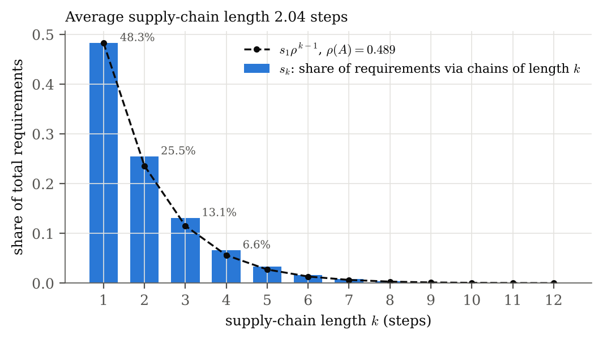
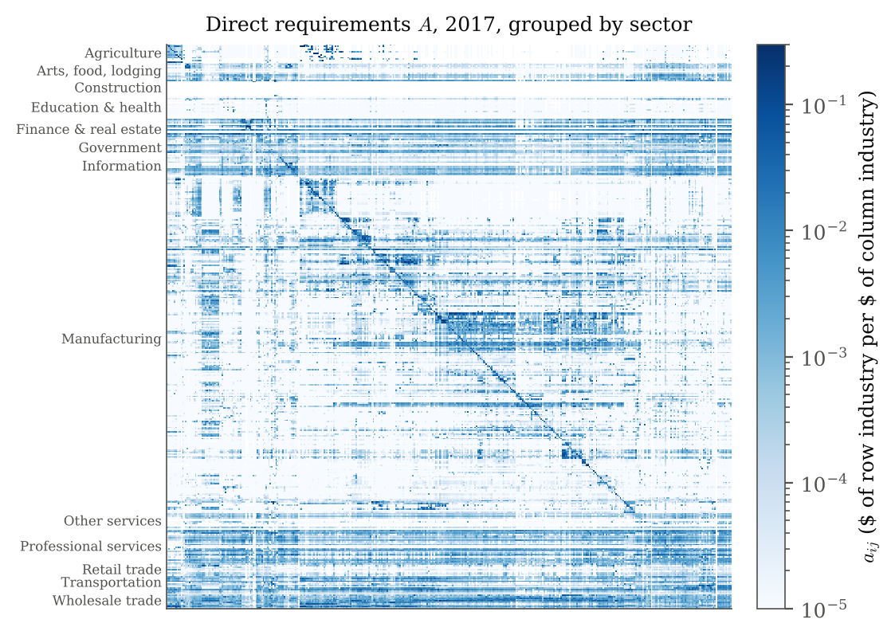
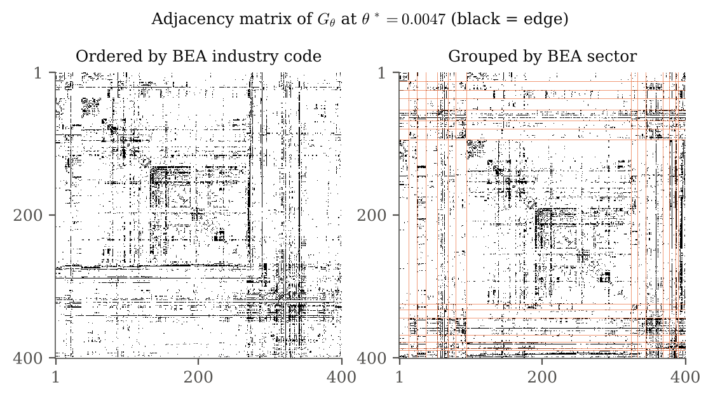
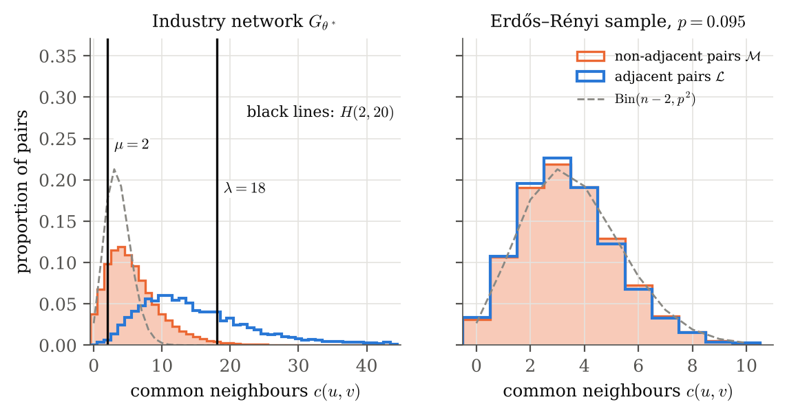
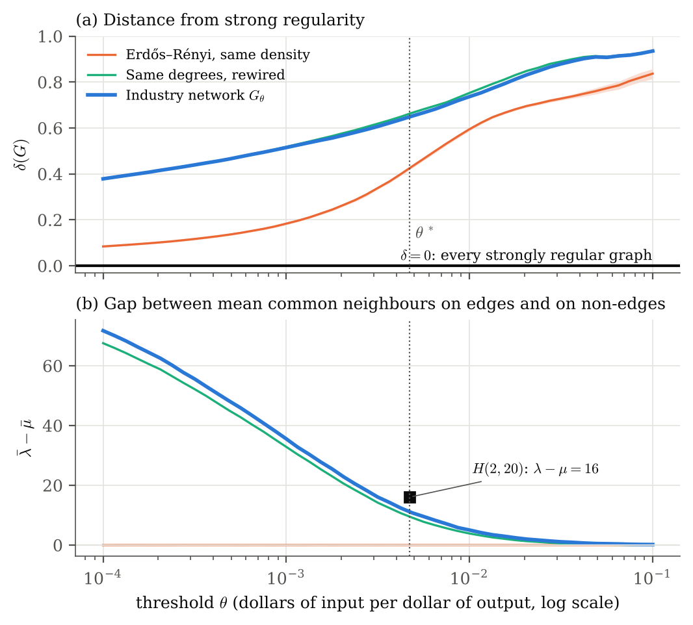
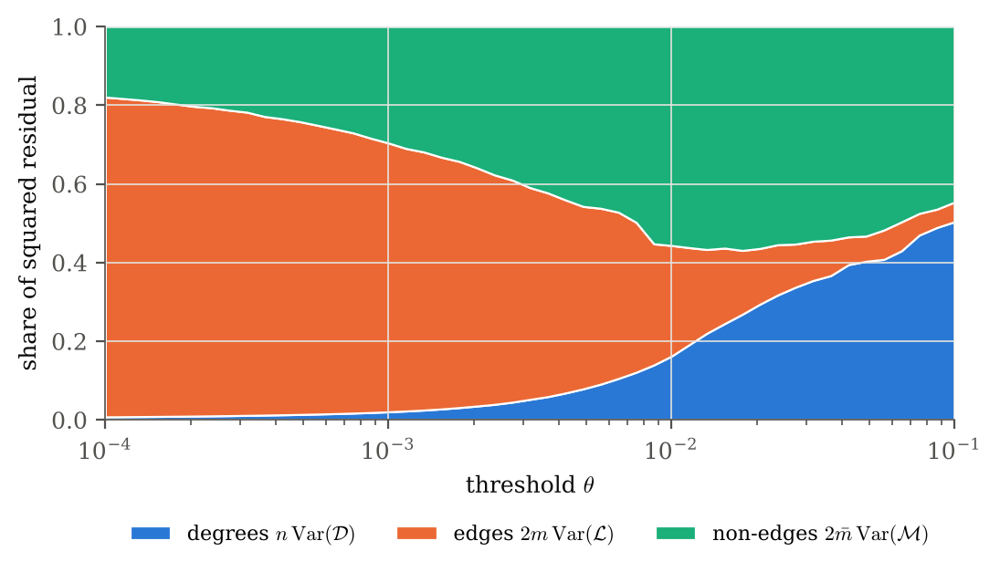
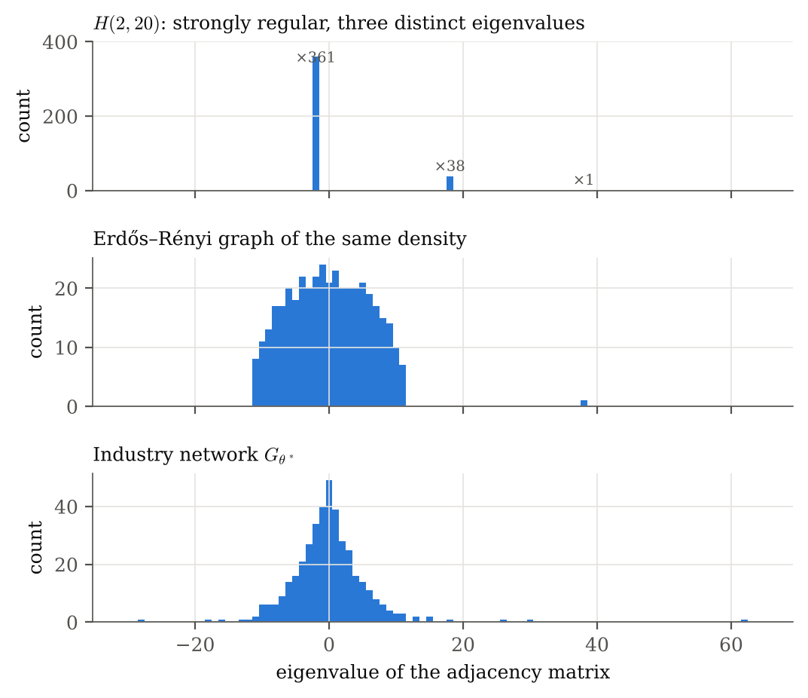
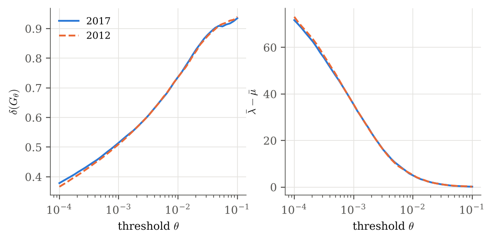
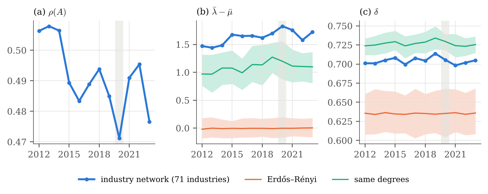

# Results

Every number below is a **computation on the public BEA input-output tables** described in [`DATA.md`](DATA.md). Unless another year is named, the numbers are for the 2017 tables at the 400-industry level. The figures are exactly as written by `scripts/run_analysis.py`, and the full record is `results/summary.json`. Statements are about these tables only.

Where a result rests on a theorem, the theorem is named, and its proof is in [`METHODS.md`](METHODS.md).

---

## 1. Supply chains as weighted walks

| Quantity | 2017 | 2012 |
|---|---|---|
| Spectral radius ρ(*A*) | 0.489 | 0.513 |
| Share via direct purchases, *s*₁ | 48.3% | 46.2% |
| Share via 2-step chains, *s*₂ | 25.5% | |
| Share via 3-step chains, *s*₃ | 13.1% | |
| Share via chains of 4+ steps | 13.1% | |
| Average chain length Σ *k s*ₖ | **2.04 steps** | 2.13 steps |
| Ratio *s*ₖ₊₁/*s*ₖ, *k* = 1…8 | 0.490 – 0.528 | |
| Max error of *I* + *A* + ⋯ + *A*²⁰ vs *L* | 1.5 × 10⁻⁷ | |
| Output multipliers (column sums of *L*) | 1.00 – 4.26, mean 2.07 | |

**Reading.** Half of all requirements are direct purchases. Each extra step in a chain carries roughly half as much as the step before, at almost exactly the rate ρ(*A*) that the Perron–Frobenius theorem says governs the decay of *A*ᵏ. The average chain, weighted by the dollars it carries, is about two steps long. Delivering $1 of final product needs about $2 of output across the economy on average.

**The ρ(*A*) < 1 check.** One industry's column of *A* sums to 1.59: state and local government passenger transit, which has negative value added in the tables. So the column-sum bound cannot certify ρ(*A*) < 1. ρ(*A*) is computed directly instead, and the Neumann series converges, as the error after 20 terms shows.

**Largest output multipliers** (longest and deepest supply chains per dollar of final product):

| Industry | Multiplier |
|---|---|
| State and local government passenger transit | 4.26 |
| Poultry and egg production | 3.22 |
| Cheese manufacturing | 3.19 |
| Fats and oils refining and blending | 3.13 |
| Poultry processing | 3.13 |
| Copper rolling, drawing, extruding and alloying | 3.11 |

The food chains are deep. Per dollar of final poultry and eggs, the column of *L* shows $0.33 of animal-feed manufacturing, $0.26 of wholesale trade, $0.25 of poultry production itself (feeding back into the industry), and $0.15 of grain farming. Per dollar of cheese, it shows $0.45 of dairy farming. The transit figure reflects its negative value added.

**Largest forward linkages** (row sums of *L*: the inputs everyone needs):

| Industry | Forward linkage |
|---|---|
| Other real estate | 18.38 |
| Management of companies and enterprises | 15.78 |
| Other durable goods merchant wholesalers | 10.88 |
| Other nondurable goods merchant wholesalers | 10.28 |
| Iron and steel mills and ferroalloy manufacturing | 10.09 |
| Petroleum refineries | 10.06 |

Full table: `results/linkages.csv`.

The dark horizontal bands are the rows of industries that sell to most other industries: finance and real estate (upper part) and professional services, transportation and wholesale trade (bottom). The dark blocks near the diagonal are supply chains within manufacturing.

## 2. The graph at θ\* = 0.0047

θ\* is the threshold at which the graph has exactly the density of *H*(2,20), so mean degree 38: an edge means one industry buys at least 0.47 cents from the other per dollar of its output.

The dense rows and columns are hub industries.

| | *H*(2,20) | Erdős–Rényi, same density | Industry network |
|---|---|---|---|
| Edges | 7,600 | 7,600 expected | 7,600 |
| Mean degree | 38 | 38 expected | 38.0 |
| Std. dev. of degree | 0 | 5.3 (one sample) | **37.6** |
| Largest degree | 38 | — | **323** |
| Components | 1 | 1 | 3 (2 isolated vertices) |
| Clique number | 20 | 5 (one sample) | 14 |
| λ̄ (mean common neighbours, adjacent pairs) | 18 | 3.61 (expectation) | 17.17 |
| μ̄ (non-adjacent pairs) | 2 | 3.61 (expectation) | 6.00 |
| λ̄ − μ̄ | 16 | 0.00 (mean of 200) | **11.17** |
| δ | 0 | 0.425 (mean of 200) | 0.649 |
| Distinct adjacency eigenvalues | 3 | 400 (one sample) | 399 |
| Largest adjacency eigenvalue | 38 | 38.4 (one sample) | 62.2 |

**Hubs.** The highest degrees are:

| Industry | Degree |
|---|---|
| Management of companies and enterprises | 323 |
| Truck transportation | 289 |
| Other real estate | 279 |
| Electric power generation, transmission, and distribution | 239 |
| Other durable goods merchant wholesalers | 217 |
| Monetary authorities and depository credit intermediation | 202 |
| Other nondurable goods merchant wholesalers | 178 |
| Employment services | 170 |
| Machinery, equipment, and supplies (wholesale) | 156 |
| Legal services | 150 |

All ten are services (head offices, freight, property, power, wholesale distribution, banking, staffing and law) that many industries buy from. 28% of all edges touch one of these ten. The two isolated vertices are "Customs duties" and "Private households", which buy no intermediate inputs.

**Sectors.** 37% of edges lie inside one of the 15 BEA sectors, against 34% of all pairs, so sectors barely concentrate edges. Within the finer 71 summary industries, 8.3% of edges lie inside one, against 2.8% of pairs. Supply links cut across sector lines much more than within them.

## 3. The instrument: common neighbours

In the random graph, adjacent and non-adjacent pairs have the same distribution of common neighbours, as Proposition `prop:er` requires. In the industry network they separate. Adjacent pairs share on average 17.17 trading partners, and non-adjacent pairs 6.00.

| At θ\* | Gap λ̄ − μ̄ |
|---|---|
| Industry network | **11.17** |
| Erdős–Rényi, 95% range | [−0.08, 0.07] |
| Same degree sequence, 95% range | [9.32, 9.77] |
| *H*(2,20) | 16 |

**Finding.** Two industries that trade directly share many more trading partners than two that do not. The effect is far larger than chance (Erdős–Rényi) and modestly larger than the hubs alone produce (degree-preserving). It is still less sharp than in the strongly regular benchmark. The gap stays above both random ranges at **every** threshold from 0.0001 to 0.1.

Within the finer summary industries, non-adjacent pairs in the same summary industry share more neighbours (11.4) than pairs in different ones (5.9). For adjacent pairs it makes almost no difference (17.1 against 17.2).

## 4. Distance from strong regularity across all thresholds

| θ | Edges | Mean degree | δ industry | δ ER 95% | δ same-degree 95% | Gap industry | Gap same-degree 95% |
|---|---|---|---|---|---|---|---|
| 0.0001 | 40,508 | 202.5 | 0.379 | [0.080, 0.088] | [0.380, 0.380] | 71.71 | [67.24, 67.91] |
| 0.0003 | 31,072 | 155.4 | 0.439 | [0.112, 0.121] | [0.440, 0.440] | 55.56 | [51.98, 52.29] |
| 0.001 | 20,379 | 101.9 | 0.515 | [0.178, 0.189] | [0.517, 0.518] | 35.51 | [32.67, 33.09] |
| 0.0032 | 10,344 | 51.7 | 0.607 | [0.333, 0.346] | [0.618, 0.621] | 16.02 | [13.94, 14.36] |
| **0.0047** | **7,600** | **38.0** | **0.649** | **[0.418, 0.433]** | **[0.660, 0.665]** | **11.17** | **[9.32, 9.77]** |
| 0.01 | 3,810 | 19.1 | 0.737 | [0.587, 0.603] | [0.748, 0.757] | 5.02 | [3.68, 4.01] |
| 0.032 | 972 | 4.9 | 0.879 | [0.721, 0.736] | [0.887, 0.892] | 1.09 | [0.42, 0.63] |
| 0.1 | 144 | 0.7 | 0.935 | [0.814, 0.858] | [0.934, 0.936] | 0.16 | [−0.00, 0.09] |

(All 49 thresholds are in `results/sweep_2017.csv`; the θ\* row is from the 50-rewiring comparison at the exact density.)

**Where each statement holds:**

- The gap is above both random ranges at every θ in [0.0001, 0.1].
- δ is above the Erdős–Rényi range at every θ in [0.0001, 0.1].
- δ is below the same-degree range at every θ in [0.0001, 0.087]. The exception is the highest threshold, θ = 0.1, where the graph has 144 edges and 240 isolated industries.

**Finding.** The industry network is further from strong regularity than a random graph of its density, but slightly closer than a random graph with its own degrees, at essentially every threshold.

### Which part of the definition fails?

At θ\*: **47%** of the squared residual comes from the spread of common neighbours across edges (std. dev. 15.2), **45%** from non-edges (std. dev. 4.8), and only **8%** from the unequal degrees (std. dev. 37.6). The degree share grows as the threshold rises and the graph thins out, reaching about half at θ = 0.1.

## 5. Spectra

*H*(2,20) has three distinct eigenvalues: 38, 18 (×38) and −2 (×361). The industry network has 399 and the random graph 400, so by this count the network is as far from strong regularity as a random graph. Its largest eigenvalue, 62.2, is far above its mean degree of 38. Strongly unequal degrees produce exactly this, since the largest eigenvalue always lies between the mean and the maximum degree.

## 6. Stability over time

**2012 vs 2017, same 400 industries.** At its own θ\* = 0.0048, the 2012 network has gap 10.73 (same-degree upper end 9.46) and δ = 0.648 (Erdős–Rényi upper end 0.432, same-degree lower end 0.663). That is the same pattern as 2017. The two sweeps are almost indistinguishable:

**Every year 2012–2023, 71 summary industries,** at the threshold matching the density of *H*(2,20) (mean degree 6.7):

| Year | ρ(*A*) | Avg chain length | *s*₁ | Gap | Gap same-degree 95% | δ | δ ER upper | δ same-degree lower |
|---|---|---|---|---|---|---|---|---|
| 2012 | 0.506 | 2.02 | 49.6% | 1.47 | [0.76, 1.32] | 0.701 | 0.661 | 0.712 |
| 2013 | 0.508 | 2.02 | 49.4% | 1.44 | [0.64, 1.32] | 0.701 | 0.667 | 0.712 |
| 2014 | 0.506 | 2.02 | 49.3% | 1.48 | [0.77, 1.36] | 0.705 | 0.665 | 0.714 |
| 2015 | 0.489 | 1.95 | 51.1% | 1.68 | [0.79, 1.39] | 0.708 | 0.664 | 0.718 |
| 2016 | 0.483 | 1.93 | 51.6% | 1.65 | [0.69, 1.25] | 0.700 | 0.659 | 0.708 |
| 2017 | 0.489 | 1.95 | 51.1% | 1.66 | [0.83, 1.48] | 0.708 | 0.668 | 0.715 |
| 2018 | 0.494 | 1.97 | 50.7% | 1.62 | [0.77, 1.49] | 0.704 | 0.661 | 0.714 |
| 2019 | 0.485 | 1.94 | 51.4% | 1.70 | [0.99, 1.53] | 0.714 | 0.665 | 0.719 |
| 2020 | 0.471 | 1.89 | 52.7% | 1.83 | [0.87, 1.56] | 0.705 | 0.668 | 0.718 |
| 2021 | 0.491 | 1.96 | 51.1% | 1.76 | [0.82, 1.41] | 0.698 | 0.667 | 0.709 |
| 2022 | 0.495 | 1.97 | 50.7% | 1.58 | [0.84, 1.34] | 0.702 | 0.662 | 0.711 |
| 2023 | 0.477 | 1.91 | 52.3% | 1.72 | [0.81, 1.36] | 0.705 | 0.668 | 0.715 |

In **all 12 years** the gap is above the same-degree range and δ lies between the two random ranges. ρ(*A*) drifts down from about 0.51 to about 0.48, with its lowest value in 2020, and the average chain length moves with it. These are descriptions of the tables; this repository makes no claim about causes.

## 7. Summary of findings

1. **Supply chains are short.** Half of all requirements are direct purchases, and the average chain is about two steps. Longer chains carry geometrically less, at rate ρ(*A*) ≈ 0.49, which is the weighted walks theorem and Perron–Frobenius in action.
2. **The network is hub-dominated.** Ten service industries touch 28% of all links at θ\*, and degrees are seven times more spread than in a random graph.
3. **Trading directly predicts shared trading partners** beyond what the hubs explain, at every threshold and in every year, though less sharply than in a strongly regular graph.
4. **What separates the network from strong regularity is variation** in shared-partner counts (92% of the residual at θ\*), not unequal degrees (8%).

What this does **not** show: anything about individual firms, other countries, or how supply chains respond to shocks.
